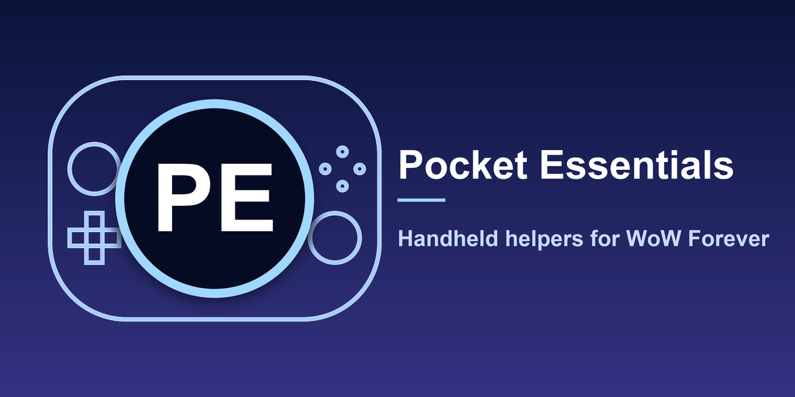
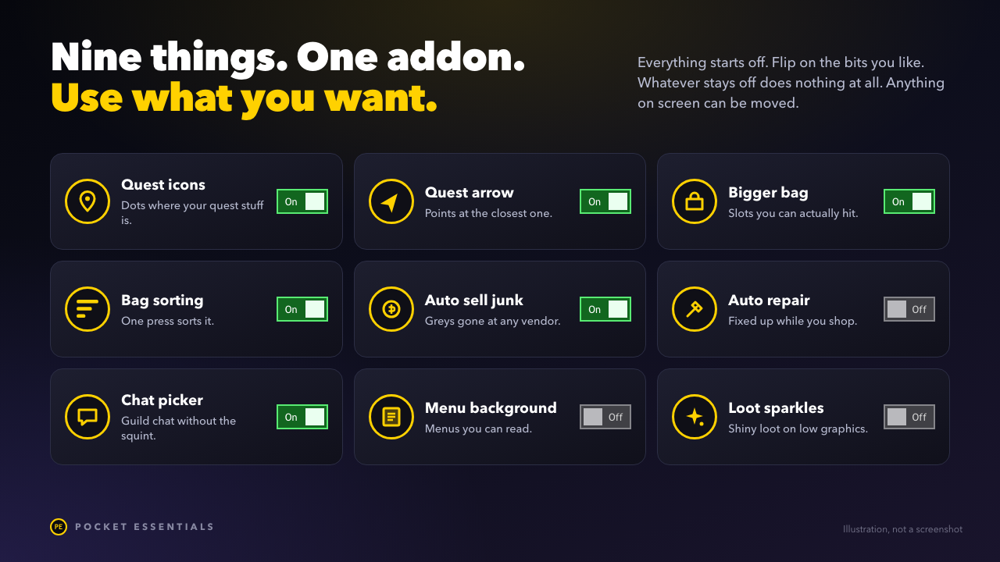

# WoW Forever Pocket Essentials

**The stuff you miss from your desktop addons, rebuilt for thumbs.** One small
addon for playing WoW Forever on a handheld, with touch and a controller
together: big buttons, no tiny targets, no typed commands.

On a handheld there is no CurseForge app and installing addons one by one is a
chore, so Pocket Essentials puts the everyday quality-of-life helpers in one
download. Each one has its own switch, everything starts **off**, and whatever
stays off does nothing at all. No libraries.



> **Status: test builds (0.15.0).** Developed and played on a Retroid Pocket 6
> at 720p. Quest icons, the quest arrow, bag sorting, auto sell junk, auto
> repair, the chat picker, the settings and the setup guide have all run on
> the device. Controller layout is **experimental** and still changing between
> builds. Bug reports are very welcome (see [Feedback](#feedback)).

## Features

### Quests
- **Quest icons:** icons on the world map and minimap where your objectives
  are (kill, loot, use, explore, turn in), one colour each, from QuestieDB's
  data. Show them for your tracked quests, the focused one or all of them;
  cap the spots per objective, merge icons that sit on top of each other,
  pick the size, and hide Blizzard's blue quest haze. A Quest icon key page
  explains the colours.
- **Quest arrow:** points to the nearest objective of your focused quest, with
  the distance. It moves on as you finish parts, leaves spots you already
  reached alone, and goes to the turn-in when you are done. Quest in another
  zone? It names the zone.

### Bags and vendors
- **Bigger bag:** the game's combined bag in three sizes, with your bags in one
  row at the top.
- **Bag sorting:** a big Sort tab on the bag, a stick click that sorts while the
  bag is open, and the d-pad reaches the tab too.
- **Auto sell junk:** open a vendor and your grey items are sold, with one line
  in chat saying what went and for how much.
- **Auto repair:** fixes your gear from your own gold.

### Chat
- **Chat picker:** tap the round **PE** button and pick who to talk to: Say,
  Party, Guild, General, Trade and so on, one big button each, plus your last
  six whisperers. A badge shows when someone is waiting on a reply.
- **Chat text size:** a simple - size + control for every chat window.

### Controller (experimental)
- **Controller layout:** the map at the bottom middle with a spell panel each
  side, drawn the way you hold the controller (d-pad spells on the left, face
  buttons on the right). Hold LT or RT and that side swaps to the trigger's
  spells. Frames, XP bar, chat and quest tracker are moved out of the way so
  the middle of the screen is yours. "Spell panel size" goes from 80% to 120%.
  Switching it off brings back your own layout.

### Game fixes
- **Menu background:** a dark panel behind the game's pop-up menus, so you can
  read them.
- **Loot sparkles:** keeps the sparkle on things you can loot or use, even on
  the lowest graphics.
- **Catch all errors:** every Lua error, from the game and other addons, in one
  list in the settings, instead of pop-ups in the middle of a fight.

### Settings and setup
- **Setup guide:** the first time you log in, a few short screens explain each
  helper and carry its switch and choices. Open it again any time.
- **Settings:** one window, a tab per area, a green dot on the ones that are
  on, big switches. Works by touch, or with the d-pad, A and B.
- **Move on screen:** nudge the quest arrow, the chat prompt and the round
  button with big arrow buttons or the d-pad. No dragging.
- **Errors tab:** if something of ours goes wrong, it shows what happened in
  plain words, and a debug log you can switch on and send.

## Install

Pocket Essentials is one addon folder, `PocketEssentials`. The quest icons and
the quest arrow also need the `QuestieDB` addon (by the Questie team); the
GitHub download includes it.

### On a handheld (from GitHub)

1. On the project's GitHub **Releases** page, download
   `wow-forever-pocket-essentials.zip` from the newest release.
2. Extract it into the game's `Interface/AddOns` folder (on the Retroid Pocket
   6 we use Droid Deck's file access). You should end up with two folders side
   by side: `PocketEssentials` and `QuestieDB`. Do not rename either.
3. If you used a very early build, delete any old `QuestDots` folder.
4. Log in. A round **PE** button appears at the left edge of the screen, and a
   moment after the loading screen the setup guide opens. Switch on what you
   want and press **Finish** (or **Skip** to leave everything off).

### From CurseForge (coming later)

Pocket Essentials will go on CurseForge with QuestieDB as a dependency once it
leaves test builds.

### Without QuestieDB

The two quest helpers stay off and the settings say why. Everything else works.

## Using it

- **Tap the round PE button** to open the settings. With the Chat picker on, a
  tap opens the picker; **hold the button a moment** to open the settings.
- While the world map is open, the round button sits on the map's book icon,
  out of the way.
- The addon button on the minimap and `/pe` open the settings too; `/pe setup`
  opens the guide.
- The **General** tab has a **Reload** button, so a reload never needs typing.
- Something wrong? Open the **Errors** tab. For a bug report, switch on the
  **Debug log**, play until it happens, tap **Save log now**, and send the file
  `WTF/Account/<account>/SavedVariables/PocketEssentials.lua`.

## Feedback

Found a bug or have an idea? Open an issue:
[github.com/ChrisMiho/wow-forever-pocket-essentials/issues](https://github.com/ChrisMiho/wow-forever-pocket-essentials/issues).
Say which device you play on and at what resolution.

## For developers

```bash
scripts/check.sh      # LuaJIT syntax check plus a comment-wording check
scripts/test.sh       # offline tests: API check, QuestieDB, feature rules, smoke test
scripts/audit-api.sh  # full check of game names against Blizzard's source (~45 s)
scripts/build.sh      # dist/wow-forever-pocket-essentials.zip (GitHub bundle)
                      # dist/PocketEssentials-<version>.zip (CurseForge, addon only)
                      # dist/PocketProbe.zip (a test-only addon that records what the game allows)
```

There is no game client off the device, so the tests run the addon against a
stand-in for the game under LuaJIT: they prove the logic, not how it looks in
game. The first test run downloads QuestieDB into `vendor/`. Every feature is
specified before it is built (`docs/superpowers/specs/`) and tested on the
handheld before it counts as working ([docs/TESTING.md](docs/TESTING.md)). See
[PRD.md](PRD.md) for the goals and working rules and [CLAUDE.md](CLAUDE.md) for
AI-assisted development in this repo, which uses the
[wow-addon-skills](https://github.com/ChrisMiho/wow-addon-skills) Claude Code
plugin.

| File | What's in it |
|------|--------------|
| [PRD.md](PRD.md) | Vision, goals, status, roadmap, parked ideas |
| [docs/ARCHITECTURE.md](docs/ARCHITECTURE.md) | How the addon is built, and what is known about the client |
| [docs/DECISIONS.md](docs/DECISIONS.md) | Why things are the way they are |
| [docs/TESTING.md](docs/TESTING.md) | Offline tests and the device test plan |
| [CHANGELOG.md](CHANGELOG.md) | What changed in each version |

## Credits and thanks

- The [Questie team](https://github.com/Questie/QuestieDB) for QuestieDB
  (GPL-3.0, also on [CurseForge](https://www.curseforge.com/wow/addons/questiedb)):
  all quest data comes from it.
- [pfQuest](https://github.com/shagu/pfQuest) by Shagu (MIT): three of the
  quest objective icons.
- [ForeverLootSparkles](https://github.com/svengabr/ForeverLootSparkles) by
  Ashtar Senior (GPL-3.0-or-later): Loot sparkles is based on it.

## Licence

GPL-3.0. See [LICENSE](LICENSE).
